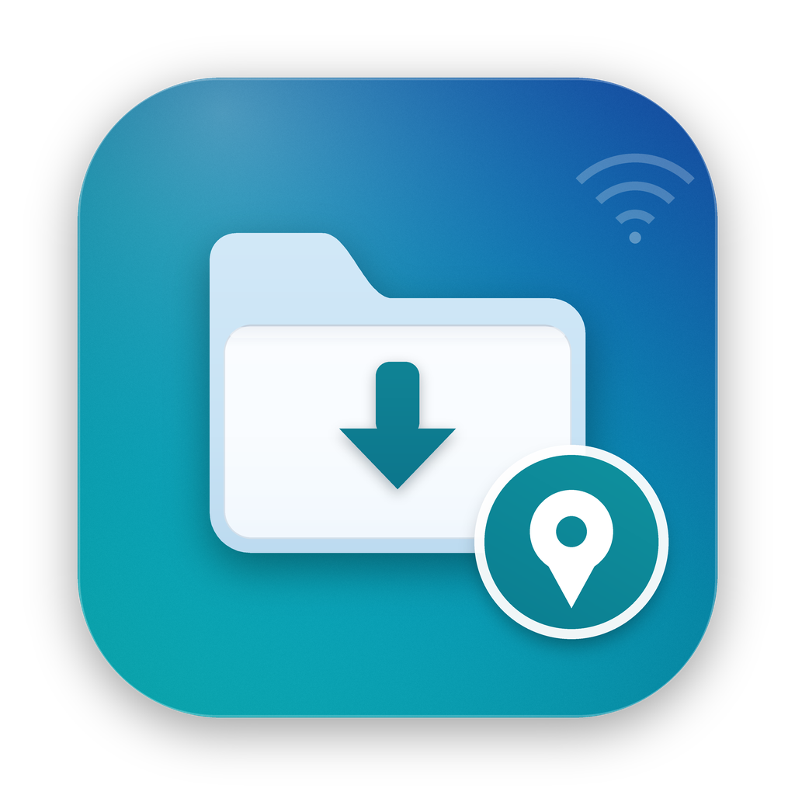

# AutoMount

A tiny macOS menu bar app that mounts an SMB share **automatically when you're on the right Wi-Fi network and physically near a saved location** — and puts a folder shortcut on your Desktop.



Think of it as a location-aware “connect to server” rule: at the office (or lab, studio, home NAS) it mounts; when you leave, it can unmount again.

## Features

- **Location-aware** — only mounts when the Mac is within a configurable radius (default 500 m) of a saved point.
- **Network-aware** — only mounts on whitelisted Wi-Fi networks (wildcards like `Office*` supported).
- **Automatic unmount** when you leave, with a grace period (default 300 s) so transfers aren't interrupted.
- **Desktop shortcut** to the mounted folder (`~/Desktop/<share name>` by default).
- **Menu bar status** — current SSID, distance to trigger, mount point, permission state, last error.
- **No password storage** — mounting goes through NetFS (the same API as Finder's “Connect to Server”), reusing credentials already saved in your login Keychain.
- **LaunchAgent** — starts at login, single-instance guarded.
- **CLI** for diagnostics and scripting.
- **macOS 26 (Tahoe) ready icon** — drawn on Apple's 824/1024 icon grid so it isn't put on the grey icon plate.

## How it works

1. A menu bar agent checks the current Wi-Fi SSID (CoreWLAN) and location (CoreLocation) every 20 seconds, plus immediately on network changes, location updates and wake.
2. If the SSID matches `wifiNames` **and** the distance to the saved `geofence` is within `radiusMeters`, it mounts `server` with `NetFSMountURLSync`.
3. It creates a symbolic link on the Desktop to the mount point.
4. When conditions stop matching, it unmounts after `unmountGraceSeconds` (if enabled).

The first run records your **current location** and **current Wi-Fi** automatically, so you only need to fill in the SMB server address.

> The UI is currently in Simplified Chinese. PRs adding localization are welcome.

## Requirements

- macOS 13 or later (Apple silicon or Intel)
- Xcode or Command Line Tools (`swiftc`) to build
- An SMB share reachable from your Mac; connect once in Finder (`⌘K`) so credentials are in the Keychain
- Location Services permission for AutoMount

## Install

```bash
git clone https://github.com/siyuanxu/automount.git
cd automount
./install.sh
```

The installer builds, signs, installs to `~/Applications/AutoMount.app`, registers a LaunchAgent, and starts the agent. No `sudo` needed.

### First-run setup

1. If macOS asks for **Location** permission, click **Allow**. If no prompt appears, enable it later in **System Settings → Privacy & Security → Location Services → AutoMount**.
2. Edit the config file:

   ```bash
   open -e "$HOME/Library/Application Support/AutoMount/config.json"
   ```

   Set `server` to your share, for example:

   ```json
   "server": "smb://192.168.1.100/Shared"
   ```

   Optionally set `desktopAliasName`, `geofence.radiusMeters`, `autoUnmountWhenLeaving`, etc. Changes are picked up within 20 seconds — no restart needed.
3. On first launch AutoMount records the current position and Wi-Fi. To re-record after moving, use the menu: **以当前位置更新触发点…** (Update trigger from current location).

### MacOS 26 icon note

The bundled icon follows Apple's 824/1024 icon grid (radius 185). If you rebuild the icon with a different shape, macOS 26 may render it on a grey “icon plate”. Use `icon/build_icon.sh` to regenerate the supplied design.

## Menu bar

| Menu item | Meaning |
|---|---|
| 状态 / Wi-Fi / 定位 / 挂载点 | Live status, SSID, distance, mount point |
| 立即挂载 | Mount now (respects conditions) |
| 卸载 | Unmount and remove desktop shortcut |
| 在 Finder 中打开 | Open the mount point |
| 立即检查 | Re-evaluate now |
| 以当前位置更新触发点… | Save current position + current Wi-Fi as triggers |
| 打开定位服务设置 | Open Location Services settings |
| 打开配置文件 / 打开日志 | Open config / log |
| 登录时自动启动 | Toggle the LaunchAgent |
| 暂停自动挂载 | Pause automatic mount/unmount (status still updates) |
| 退出 | Quit the agent (restarts at next login) |

## Configuration

Path: `~/Library/Application Support/AutoMount/config.json`

```json
{
  "server": "smb://192.168.1.100/Shared",
  "volumeName": "Shared",
  "desktopAliasName": "",
  "wifiNames": [],
  "geofence": null,
  "autoUnmountWhenLeaving": true,
  "unmountGraceSeconds": 300,
  "maxFixAgeSeconds": 600,
  "openFinderOnMount": false
}
```

| Key | Description |
|---|---|
| `server` | SMB URL, e.g. `smb://host/share` |
| `volumeName` | Display name only |
| `desktopAliasName` | Desktop shortcut name; empty = derive from share name |
| `wifiNames` | Whitelist, supports `*` and `?`; empty = learn current network on first run |
| `geofence` | `{latitude, longitude, radiusMeters}`; `null` = learn current position on first run |
| `autoUnmountWhenLeaving` | Unmount when conditions stop matching |
| `unmountGraceSeconds` | Delay before unmounting (0 = immediate) |
| `maxFixAgeSeconds` | How old a location fix may be before it is discarded |
| `openFinderOnMount` | Open a Finder window after mounting |

## CLI

```bash
APP="$HOME/Applications/AutoMount.app/Contents/MacOS/AutoMount"

"$APP" --status                 # status JSON
"$APP" --check                  # exit 0 when conditions are met
"$APP" --mount [--force]        # mount now
"$APP" --unmount                # unmount now
"$APP" --learn-current          # save current position + Wi-Fi
"$APP" --init                   # write default config
"$APP" --install-agent          # register LaunchAgent
"$APP" --uninstall-agent        # remove LaunchAgent
"$APP" --remove-desktop-alias   # remove the desktop shortcut
"$APP" --version
```

`--status` and `--check` read the running agent's live status when available.

## Uninstall

```bash
cd automount
./uninstall.sh          # keep config and logs
./uninstall.sh --purge  # remove everything
```

## Build from source

```bash
./build.sh          # builds build/AutoMount.app
./install.sh        # builds + installs + registers the LaunchAgent
```

Signing: `build.sh` uses `SIGN_ID` if set, otherwise the first `Apple Development` identity found, otherwise ad-hoc. Location permission is tied to the code signature; ad-hoc builds may require re-approving after each rebuild.

## Privacy

- No analytics, telemetry, or network calls other than mounting your configured SMB share.
- Your SMB password is never read or stored by the app; NetFS uses the credentials already in your Keychain.
- The config file contains only your server address, Wi-Fi names and a geofence — it stays on your Mac.

## License

MIT — see [LICENSE](LICENSE).
