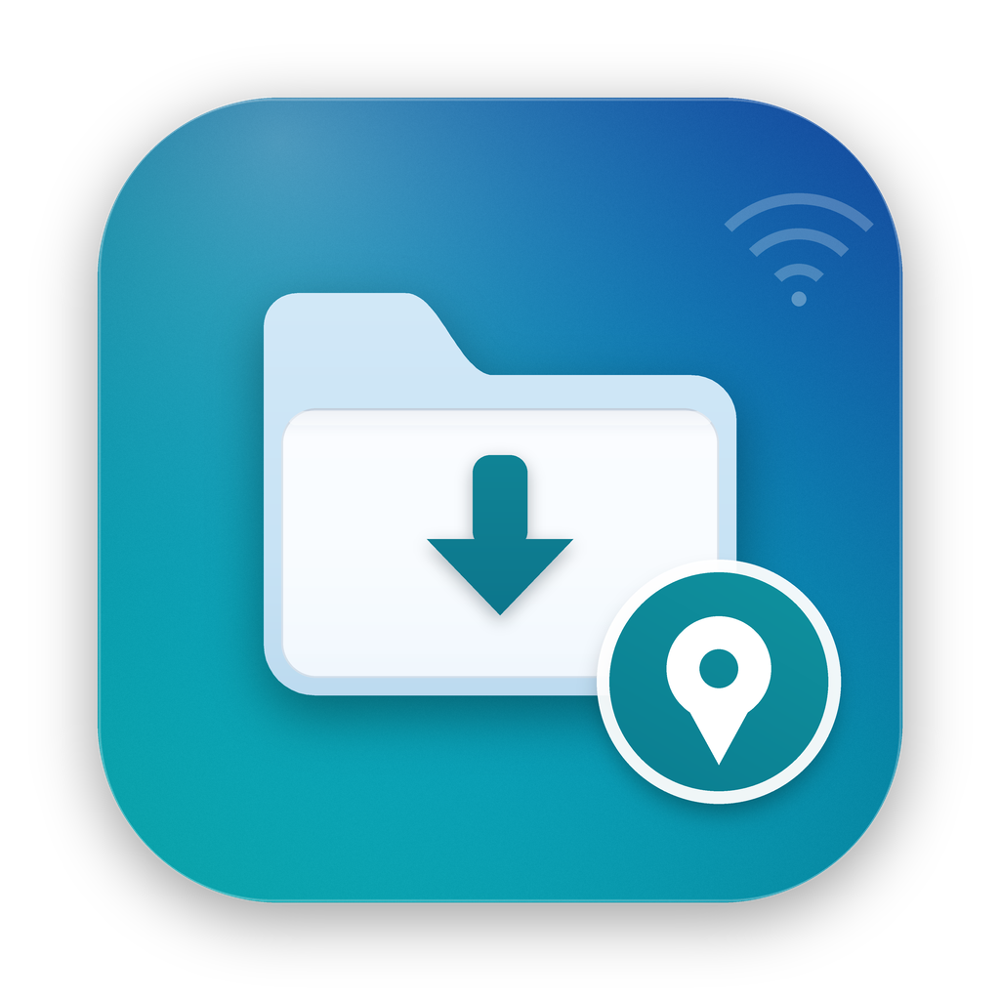

# AutoMount

一个 macOS 菜单栏小工具：**当你连上指定的 Wi-Fi，并且定位在预设位置附近时，自动挂载 SMB 共享文件夹**，并在桌面生成入口；离开后自动卸载。



相当于一条“到达办公室（或实验室、家里 NAS）就自动连接服务器”的规则。

## 功能

- **定位感知**：只在距离预设触发点 `radiusMeters`（默认 500 米）以内挂载。
- **网络感知**：只在 Wi-Fi 白名单内挂载，支持 `*`、`?` 通配符（例如 `Office*`）。
- **离开自动卸载**：默认等待 300 秒，避免打断正在传输的文件。
- **桌面入口**：在 `~/Desktop/<共享名>` 创建指向挂载点的符号链接。
- **菜单栏实时状态**：当前 SSID、距触发点距离、挂载点、定位权限、最近错误。
- **不保存密码**：通过 NetFS（与 Finder「连接服务器」相同的 API）挂载，复用系统钥匙串里已有的凭据。
- **登录自动启动**：LaunchAgent，单实例保护。
- **命令行工具**：便于诊断和脚本化。
- **适配 macOS 26 图标网格**：不会被 Tahoe 放进灰色图标底板。

## 工作原理

1. 菜单栏后台程序每 20 秒检查一次当前 Wi-Fi（CoreWLAN）和定位（CoreLocation）；网络变化、定位更新、系统唤醒时也会立即检查。
2. 当 SSID 命中 `wifiNames`，且与 `geofence` 的距离小于 `radiusMeters` 时，调用 `NetFSMountURLSync` 挂载 `server`。
3. 在桌面创建指向挂载点的符号链接。
4. 条件不再满足时，等待 `unmountGraceSeconds` 后卸载（可关闭）。

首次运行会自动记录**当前位置**和**当前 Wi-Fi**，你只需要填写 SMB 服务器地址。

> 界面目前为简体中文，欢迎提交本地化 PR。

## 系统要求

- macOS 13 或更高（Apple silicon / Intel 均可）
- Xcode 或 Command Line Tools（`swiftc`）
- 能从本机访问的 SMB 共享；建议先在 Finder 里 `⌘K` 连接一次，把凭据存进钥匙串
- 为 AutoMount 授予定位权限

## 安装

### 方式 A：直接下载 Release（推荐）

从 [Releases](https://github.com/siyuanxu/automount/releases/latest) 下载最新的 `AutoMount-<版本>.zip`，解压后把 `AutoMount.app` 拖到 `~/Applications`（或 `/Applications`）。

Release 包是 **ad-hoc 签名**（未做公证）。第一次打开时请右键 App →「打开」，或先移除隔离属性：

```bash
xattr -dr com.apple.quarantine "$HOME/Applications/AutoMount.app"
```

先启动一次 App，然后在菜单栏图标里打开「登录时自动启动」。

### 方式 B：源码构建

```bash
git clone https://github.com/siyuanxu/automount.git
cd automount
./install.sh
```

安装脚本会构建、签名、安装到 `~/Applications/AutoMount.app`，注册登录启动项并启动，**不需要 sudo**。

### 首次配置

1. 如弹出**定位**授权，点「允许」；若没有弹窗，之后到「系统设置 → 隐私与安全性 → 定位服务」中打开 AutoMount。
2. 编辑配置文件：

   ```bash
   open -e "$HOME/Library/Application Support/AutoMount/config.json"
   ```

   把 `server` 改成你的共享地址，例如：

   ```json
   "server": "smb://192.168.1.100/Shared"
   ```

   还可以设置 `desktopAliasName`、`geofence.radiusMeters`、`autoUnmountWhenLeaving` 等。保存后 20 秒内自动生效，无需重启。
3. 首次启动会自动记录当前定位和 Wi-Fi。换了位置后，可在菜单里点「以当前位置更新触发点…」。

## 菜单栏

| 菜单项 | 作用 |
|---|---|
| 状态 / Wi-Fi / 定位 / 挂载点 | 实时状态 |
| 立即挂载 | 条件满足时手动挂载 |
| 卸载 | 卸载并移除桌面入口 |
| 在 Finder 中打开 | 打开挂载点 |
| 立即检查 | 立刻重新判断 |
| 以当前位置更新触发点… | 把当前定位和 Wi-Fi 记录为触发条件 |
| 打开定位服务设置 | 定位未授权时使用 |
| 打开配置文件 / 打开日志 | 排查问题 |
| 登录时自动启动 | 开关 LaunchAgent |
| 暂停自动挂载 | 临时暂停自动挂载/卸载 |
| 退出 | 退出菜单栏程序（下次登录会再启动） |

## 配置文件

路径：`~/Library/Application Support/AutoMount/config.json`

```json
{
  "server": "smb://192.168.1.100/Shared",
  "volumeName": "Shared",
  "desktopAliasName": "",
  "wifiNames": [],
  "geofence": null,
  "autoUnmountWhenLeaving": true,
  "unmountGraceSeconds": 300,
  "maxFixAgeSeconds": 600,
  "openFinderOnMount": false
}
```

| 字段 | 说明 |
|---|---|
| `server` | SMB 地址，如 `smb://host/share` |
| `volumeName` | 仅用于展示 |
| `desktopAliasName` | 桌面入口名称；留空则自动使用共享名 |
| `wifiNames` | Wi-Fi 白名单，支持 `*` `?`；留空则首次运行自动学习当前网络 |
| `geofence` | `{latitude, longitude, radiusMeters}`；`null` 表示首次运行自动记录当前位置 |
| `autoUnmountWhenLeaving` | 离开后是否自动卸载 |
| `unmountGraceSeconds` | 离开后延迟多少秒再卸载（0 = 立即） |
| `maxFixAgeSeconds` | 定位结果最多使用多久 |
| `openFinderOnMount` | 挂载后是否自动打开 Finder 窗口 |

## 命令行

```bash
APP="$HOME/Applications/AutoMount.app/Contents/MacOS/AutoMount"

"$APP" --status                 # 状态 JSON
"$APP" --check                  # 条件满足返回 0
"$APP" --mount [--force]        # 立即挂载
"$APP" --unmount                # 立即卸载
"$APP" --learn-current          # 记录当前位置和 Wi-Fi
"$APP" --init                   # 生成默认配置
"$APP" --install-agent          # 安装登录启动项
"$APP" --uninstall-agent        # 移除登录启动项
"$APP" --remove-desktop-alias   # 移除桌面入口
"$APP" --version
```

App 正在运行时，`--status` / `--check` 会读取它的实时状态。

## 卸载

```bash
cd automount
./uninstall.sh          # 保留配置和日志
./uninstall.sh --purge  # 全部删除
```

## 从源码构建

```bash
./build.sh          # 构建 build/AutoMount.app
./install.sh        # 构建 + 安装 + 注册登录启动项
```

签名：`build.sh` 优先使用环境变量 `SIGN_ID`，否则自动选择本机第一个 `Apple Development` 证书，没有则使用 ad-hoc 签名。定位权限与代码签名绑定，ad-hoc 重建后可能需要重新授权。

## 隐私

- 无统计、无遥测；除挂载你配置的 SMB 共享外不发起其他网络请求。
- App 不读取、不保存 SMB 密码，挂载复用系统钥匙串中的凭据。
- 配置文件只包含服务器地址、Wi-Fi 名称和地理围栏，保存在本机。

## 许可证

MIT，见 [LICENSE](LICENSE)。
